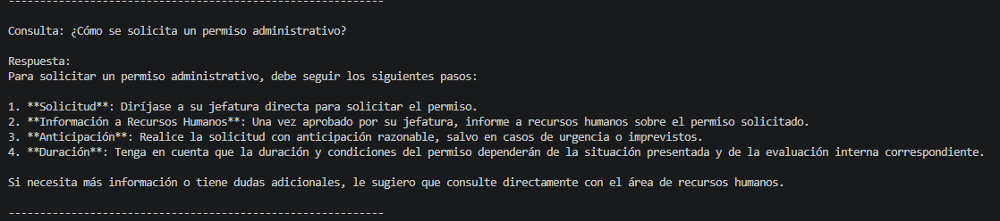
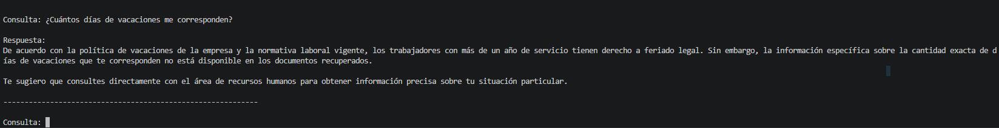

# Agente Inteligente de RRHH - LLM y RAG

Asistente de recursos humanos que recupera información relevante de documentos y genera respuestas contextualizadas mediante modelos de lenguaje. El proyecto aborda consultas frecuentes sobre vacaciones, permisos, beneficios y procedimientos internos, mostrando las fuentes utilizadas.

## Funcionalidades

- Consultas en lenguaje natural mediante consola.
- Fragmentación de documentos y generación de embeddings.
- Recuperación semántica con FAISS.
- Generación de respuestas mediante un LLM y contexto documental.
- Identificación de fuentes y orientación ante información insuficiente.

## Arquitectura

| Etapa | Responsabilidad |
| --- | --- |
| Ingesta | Lectura y fragmentación de documentos TXT. |
| Indexación | Embeddings e índice vectorial FAISS en memoria. |
| Recuperación | Selección de fragmentos relevantes para la consulta. |
| Generación | LangChain y GitHub Models. |
| Presentación | Respuesta y referencias en consola. |

## Tecnologías

Python, LangChain, FAISS, GitHub Models, GPT-4o-mini, embeddings, Git y GitHub.

## Estructura

- `app.py`: interfaz de consola.
- `src/`: carga documental, indexación y lógica RAG.
- `data/`: documentación ficticia de ejemplo.
- `requirements.txt`: dependencias.
- `.env.example`: configuración sin credenciales.

## Ejecución original (referencia histórica)

Se recomienda Python 3.12 de 64 bits (compatibilidad de dependencias aún no verificada), acceso a GitHub Models y un token propio con permisos mínimos necesarios.

```cmd
python -m venv .venv
.venv\Scripts\python -m pip install -r requirements.txt
copy .env.example .env
```

Completar `.env` con el token propio. Los modelos y el endpoint son configurables. Los siguientes pasos se conservan como referencia del funcionamiento original, no como una guía de ejecución actualmente operativa.

```cmd
.venv\Scripts\python app.py
```

Ejemplos: ¿Cómo solicito vacaciones? ¿Qué beneficios existen? ¿Cómo solicito un permiso?

## Evidencias de funcionamiento

Capturas originales de las pruebas del prototipo académico mediante consola, conservadas sin modificaciones. Las imágenes muestran respuestas históricas, no pruebas de la versión de portafolio actual.

| Prueba | Consulta | Evidencia |
| --- | --- | --- |
| 1 | Solicitud de permiso administrativo | [Ver captura](evidencias/capturas_pruebas/pregunta-1.png) |
| 2 | Días de vacaciones; reconocimiento de información insuficiente | [Ver captura](evidencias/capturas_pruebas/pregunta-2.png) |
| 3 | Procedimiento ante licencia médica | [Ver captura](evidencias/capturas_pruebas/pregunta-3.png) |
| 4 | Beneficios internos | [Ver captura](evidencias/capturas_pruebas/pregunta-4.png) |
| 5 | Canal de consultas de RRHH | [Ver captura](evidencias/capturas_pruebas/pregunta-5.png) |





Las capturas documentan las respuestas del prototipo; la lógica de identificación de fuentes se encuentra en `src/rag_pipeline.py`. No todas las capturas muestran fuentes explícitas.

## Seguridad y alcance

La versión de portafolio contiene documentos ficticios y no incorpora credenciales, índices serializados ni registros personales. El índice se genera en memoria en la primera consulta y se reutiliza durante la sesión, evitando la deserialización de archivos pickle. El procesamiento con modelos remotos envía fragmentos y consultas al proveedor: no introducir información confidencial. Las respuestas pueden contener errores y no constituyen asesoría laboral o legal.

Proyecto desarrollado en equipo en un contexto formativo. Adaptación de portafolio con asistencia de IA. La ejecución histórica requería credenciales propias. La redistribución está sujeta a los derechos correspondientes.

## Estado del proyecto

El repositorio conserva la arquitectura y las tecnologías utilizadas durante su desarrollo original. Debido a cambios posteriores en la disponibilidad del servicio de inferencia de GitHub Models, la ejecución mediante el proveedor original ya no se encuentra disponible. Las evidencias de las pruebas realizadas durante su desarrollo permiten visualizar el funcionamiento del asistente y las respuestas obtenidas.
